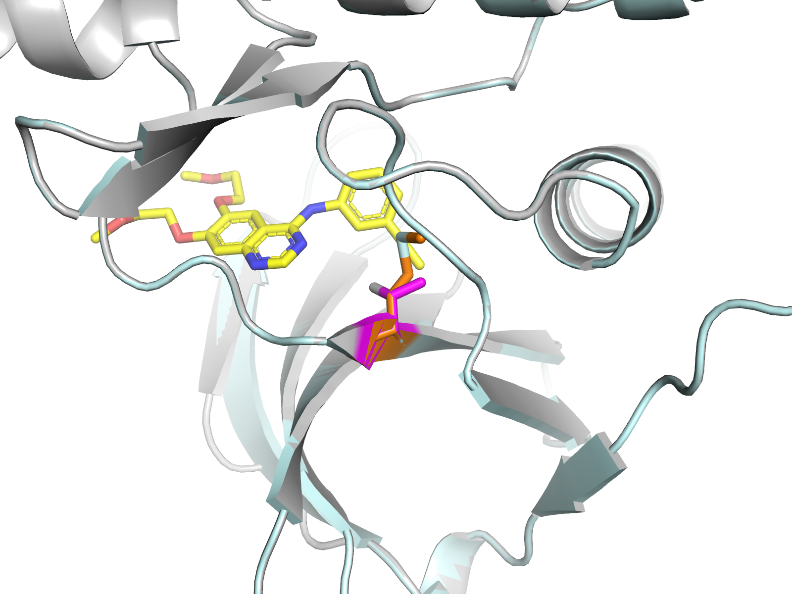
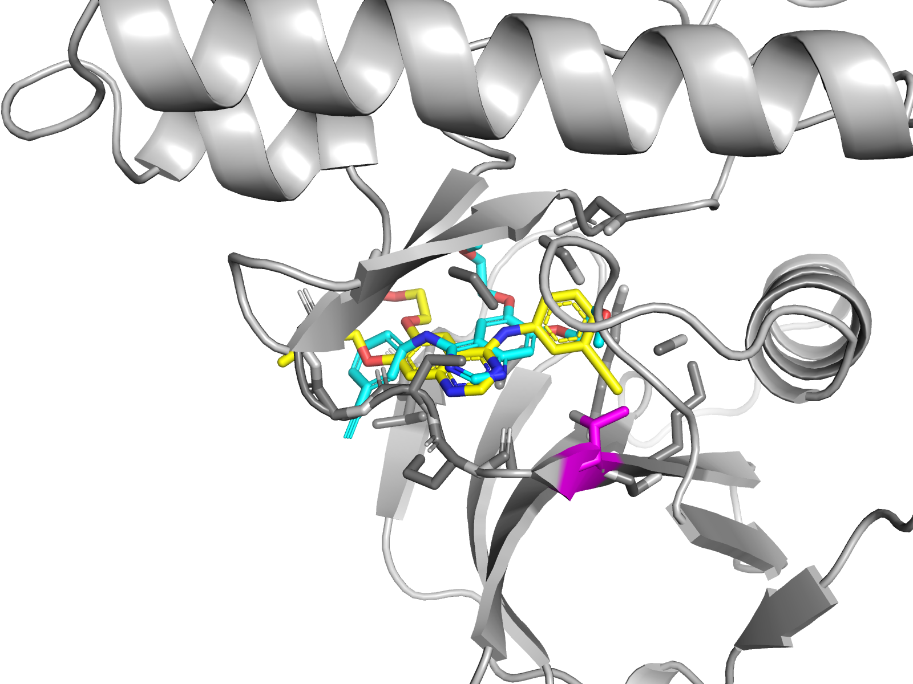
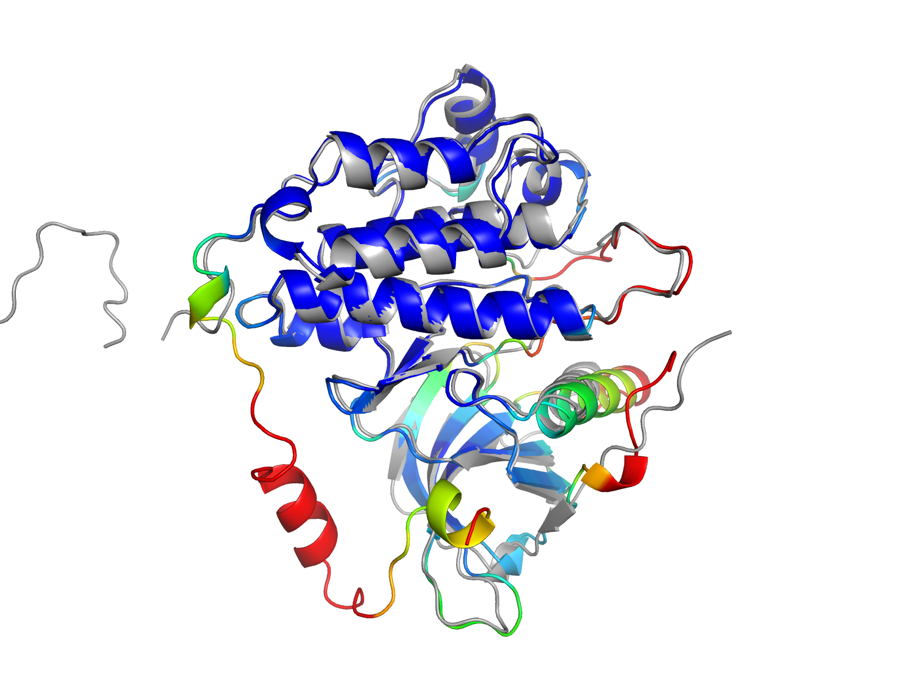

# Variant-aware docking: EGFR wild-type vs mutants

**Author:** Garv Gupta, B.Tech Biotechnology

A reproducible Python pipeline that docks EGFR inhibitors into wild-type and mutant EGFR structures with AutoDock Vina, and checks how much the results can be trusted.

The question: does an EGFR mutation (for example T790M) change how well a drug binds in docking, and is that change larger than the noise of the method itself?

## Pipeline

1. **Gene discovery:** DESeq2 on GEO GSE81089 (lung tumor vs normal, 218 samples), see `01_rnaseq/`.
2. **Mutation set:** L858R, T790M, C797S, G719S and L858R/T790M, chosen from the literature.
3. **Structures:** wild-type and mutant receptors prepared from PDB 1M17 (EGFR with erlotinib) using PDBFixer, see `03_structures/`.
4. **Docking:** Vina, box centre (22.01, 0.25, 52.79), size 22 Å, exhaustiveness 16, see `04_docking/`.
5. **Validation:** re-docking, 5-seed robustness test, negative control, AlphaFold comparison.

## Results

### Re-docking of the co-crystal ligand (erlotinib into 1M17)

| Setting | Top-ranked pose RMSD | Best RMSD among poses |
|---|---|---|
| Box 22 Å, exhaustiveness 16 (used in this project) | 4.16 Å | 1.31 Å (9 poses) |
| Box 14 Å, exhaustiveness 32 | 4.03 Å | 3.50 Å (8 poses) |

Vina generated a pose within 2 Å of the crystal pose, but it was not the top-ranked one. The scoring function does not put the native-like pose first.

### Wild-type vs T790M (5 seeds, mean kcal/mol)

| Compound | Wild-type | T790M | T790M minus WT |
|---|---|---|---|
| Erlotinib | -7.03 | -6.70 | +0.33 |
| Osimertinib | -8.64 | -8.67 | -0.03 |
| Aspirin (negative control) | -5.81 | -5.29 | +0.52 |

Seed-to-seed standard deviation was 0.02 to 0.17 kcal/mol, so the runs are reproducible.

Erlotinib binds the T790M receptor slightly worse, the direction expected for resistance, and osimertinib shows no change, as expected for a T790M-targeted drug. However, the aspirin control shifted by a similar or larger amount, so the erlotinib shift is not specific to the drug-mutation pair.

### AlphaFold vs experimental wild-type (5 seeds, mean kcal/mol)

| Compound | Experimental WT | AlphaFold | Difference |
|---|---|---|---|
| Erlotinib | -7.03 | -6.72 | +0.31 |
| Osimertinib | -8.64 | -7.47 | +1.17 |
| Aspirin | -5.81 | -5.55 | +0.26 |

- The drug ranking (osimertinib, erlotinib, aspirin) is the same on both structures.
- Absolute scores are weaker on the AlphaFold model, most of all for osimertinib. A possible reason is that 1M17 was crystallised with erlotinib, while the AlphaFold model has no ligand. This was not tested.
- Structure superposition: CA RMSD 0.86 Å over 239 residues with pLDDT of 70 or more.
- Pocket pLDDT: 73 to 90 for residues 718, 719, 726, 745, 790, 793, 797 and 855. Residue 858 (L858) scores 51, so AlphaFold results say nothing reliable about L858R.

## Limitations

- Switching from the crystal to the AlphaFold structure shifts erlotinib by +0.31 kcal/mol, almost the same as the T790M effect (+0.33), and the negative control shifts by +0.52. The T790M effect on erlotinib is therefore within the noise of the method.
- The top-ranked re-docking pose is 4.16 Å from the crystal pose, so absolute scores and poses should be read with caution.
- Vina cannot model the covalent bond between osimertinib and C797.
- No decoy-based validation (ROC-AUC, enrichment factor) has been done yet.
- No consensus scoring with a second docking program, no molecular dynamics, no ADMET filtering.
- Mutation frequencies (gnomAD, ClinVar, population data) were not looked up, so there is no population-specific analysis.

## Future work

- DUD-E actives and decoys for EGFR, with ROC-AUC and EF1%.
- Consensus scoring with GNINA.
- Population-frequency annotation of the mutations, including Indian-population data.
- Short MD simulation of the top hits.

## Reproducing

Scripts run in order: `03_structures/prepare_structures.py`, `04_docking/prepare_inputs.py`, `04_docking/dock_all.py`, `04_docking/seed_test.py`, `04_docking/af_dock.py`. Environment: see `environment.yml`.

## Data and tools

GEO GSE81089, PDB 1M17, AlphaFold DB (P00533), AutoDock Vina, PDBFixer, Open Babel, RDKit, Biopython, DESeq2.

## Figures

Gatekeeper residue 790 (T790, magenta) vs T790M (orange) next to crystal erlotinib (yellow). The mutant side chain was modelled with PDBFixer, not taken from a crystal structure.

Top-ranked Vina pose (cyan) vs crystal erlotinib (yellow), 4.16 Å apart. Another pose reached 1.31 Å.

AlphaFold model coloured by pLDDT (blue high, red low) on the 1M17 crystal structure (grey). CA RMSD 0.86 Å over 239 residues.
